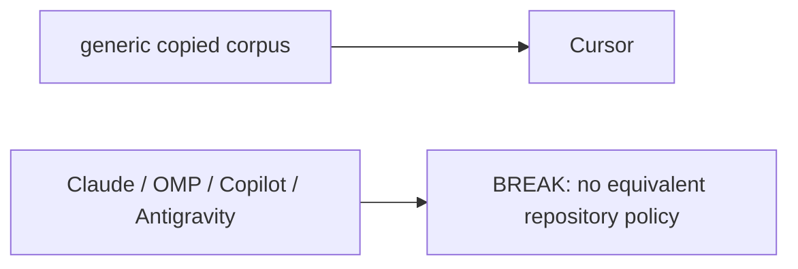
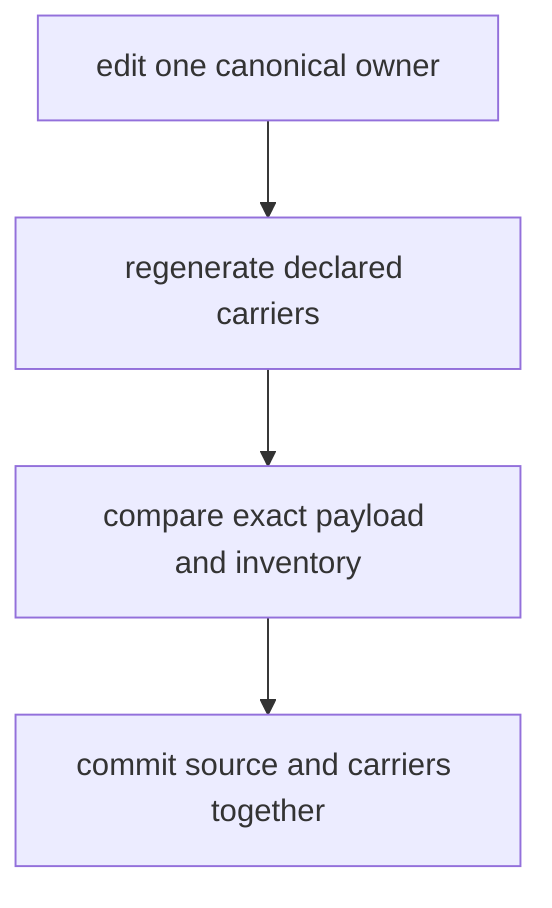

# ADR-0001: Centralize agent policy under the repository harness

| Field | Value |
|---|---|
| Status | accepted |
| Date | 2026-09-13 |
| Deciders | Alex ATorres |
| Scope | Repository-local agent instructions and their client projections |

## Context and Problem Statement

**Symptom (observable).** Gloton had dozens of generic style guides and Cursor rules, no root `AGENTS.md` or `CLAUDE.md`, and no executable link between copied policy and other agent clients.

**Root cause (the mechanism).** Independently editable client files multiply owners for one obligation. A future edit reaches one client while other clients retain stale bytes.

**Causal chain:**

```text
one repository obligation
    ↓ copied into independently editable client files
multiple policy owners
    ↓ one copy changes without regenerating the others
different agents receive contradictory repository behavior
```

**Scope.** IN: ownership, routing, generation, and parity of repository-local agent policy. OUT: product behavior, GitHub authorization, and global user-level agent configuration.

## Decision Drivers

| Driver | Weight | Measurable criterion | Source |
|---|---|---|---|
| One owner per obligation | MUST | Every generated carrier names one canonical source and matches its payload bytes | `[per: .ai/harness/rules/RULES.md]` |
| Current client coverage | MUST | All registry-declared emitted rule surfaces have the exact expected carrier set | `[per: .ai/harness/agent-registry.tsv]` |
| Human-maintainable policy | SHOULD | Project-specific normative text is written once under `.ai/harness/` | `CONTRIBUTING.md` |
| Runtime honesty | SHOULD | File parity is not described as client runtime arrival | `.ai/harness/context/gotchas-limitations.md` |

## Considered Options

1. **Option A — canonical `.ai/harness` sources with generated carriers** (chosen)
2. **Option B — maintain independent client-native rules**
3. **Option 0 — keep the copied Cursor-only corpus**

### Option A — canonical sources with generated carriers

- **Mechanism.** Three core sources partition disposition, unconditional obligations, and routes. Detailed rules are copied into registry-declared native carriers; repository tests compare payload bytes and inventory.
- **Falsifier.** Reject this option if a target client cannot consume any declared root or emitted rule surface without an independently authored policy body.
- **Reversal cost.** Remove generated carriers and tests, then choose new policy owners. Client settings and stale cached instructions may remain out of band and require manual inspection.


### Option B — independent client-native rules

- **Mechanism.** Each client receives hand-authored policy optimized for its syntax.
- **Falsifier.** Reject this option if one obligation must apply to more than one client and no cross-owner conflict detector exists.
- **Reversal cost.** Select surviving owners and delete or archive every other copy; client caches remain outside repository teardown.

```text
obligation -> Claude copy
           -> Cursor copy -> BREAK: later edit reaches only this branch
           -> OMP copy
```

### Option 0 — keep the Cursor-only corpus

- **Mechanism.** Existing `.cursor/rules` remain the only rule surface; other clients rely on no repository-local equivalent.
- **Falsifier.** Reject this option if `AGENTS.md`, `CLAUDE.md`, or another requested client must receive repository rules.
- **Reversal cost.** None now; later migration must classify every copied rule and remove stale content.



## Decision Outcome

**Chosen: Option A.**



| Driver | Weight | Option A | Option B | Option 0 |
|---|---|---|---|---|
| One owner per obligation | MUST | ✓ | ✗ ¹ | ✗ |
| Current client coverage | MUST | ✓ | ✓ | ✗ ² |
| Human-maintainable policy | SHOULD | ✓ | Partial | ✗ |
| Runtime honesty | SHOULD | Partial ³ | Partial | ✗ |

¹ Independent files remain multiple owners by construction.
² Cursor-only policy does not cover the requested root and client surfaces.
³ Byte parity proves repository projection, not external client arrival.

**Trade-offs accepted.** Generated files enlarge the tree and must be regenerated with source changes. That cost is bounded by one canonical edit path and an exact repository test.

**Reconsider if.** Supersede this ADR if a supported client has no canonical-to-native projection route and requires an independently owned semantic policy body.

## Consequences

| Polarity | Consequence | Note / mitigation |
|---|---|---|
| Positive | Agent-facing policy has one editable owner per obligation. | Source markers and payload tests reject drift. |
| Positive | Root and client-specific consumers receive explicit carriers. | Registry-derived inventory bounds emission. |
| Negative / risk | Generated policy adds repository files. | Keep only routed Gloton/governance rules and prune unused stacks. |
| Negative / risk | External clients may ignore a valid carrier. | Report effective-load evidence tiers; never promote parity to runtime arrival. |

## Evidence

- Existing policy multiplication — pre-retrofit inventory of `docs/styleguides/**` and `.cursor/rules/**`, 2026-09-13.
- Canonical ownership and discriminating verification — `.ai/harness/rules/RULES.md`.
- Exact emitted membership — `.ai/harness/agent-registry.tsv`.
- Implemented by `.ai/harness/`, generated root/client carriers, and `tests/harness.rs`.
