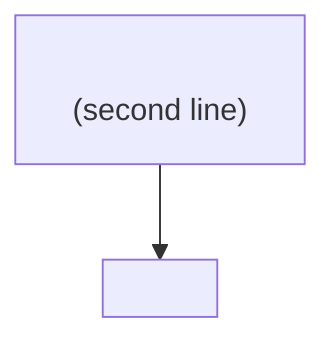

# ADR-NNNN: <decision title>

<!--
  THE BAR (this template is the canonical, append-only, NASA-grade ADR form).
  Fill every section. Delete these HTML comments and any section that is genuinely n/a
  (say WHY it is n/a — do not leave an empty heading). Zero AI-slop: every sentence must
  change the decision or cite evidence. If a sentence loses no information when deleted, delete it.
-->

| Field    | Value |
|----------|-------|
| Status   | proposed |
| Date     | YYYY-MM-DD |
| Deciders | <names> |
| Scope    | <the one subsystem/boundary this decision governs> |

## Context and Problem Statement

<!-- Symptom → root cause → causal chain → scope. Cite factual claims. -->

**Symptom (observable).** <What is observably true that forces a decision.>

**Root cause (the mechanism).** <The mechanism that makes a choice necessary — not a preference,
a forcing function. Cite it `[per: …]` / `file:line`.>

**Causal chain** (each hop a mechanical step; this ASCII arrow block is REQUIRED — it is the one
machine-checked visual):

```text
<Component A> [per: source]
    ↓ <mechanical action>
<Intermediate state>
    ↓ <mechanical action>
<Observable symptom / forcing function>
```

**Scope.** IN: <what this decides>. OUT: <what it explicitly does not decide>.

## Decision Drivers

<!-- Each driver: weight (MUST | SHOULD | NICE) + a MEASURABLE criterion + a source. No vibes. -->

| Driver | Weight | Measurable criterion | Source |
|--------|--------|----------------------|--------|
| <driver> | MUST | <how you'd measure it> | `[per: …]` / `file:line` |
| <driver> | SHOULD | <…> | <…> |

## Considered Options

<!-- ≥2 REAL options. If there was only one viable path, this is not an ADR — it is a comment. -->

1. **Option A — <name>** (chosen)
2. **Option B — <name>**
3. **Option 0 — status quo / do nothing** <!-- score it too; "keep status quo" can be the right ADR -->

### Per option (repeat for each)

- **Mechanism (how + why).** <How it works, fused with WHY it works that way. Cite claims.>
- **Falsifier (condition-based, pre-flightable).** Fails IF <a specific PRECONDITION a reader can test
  BEFORE committing — a missing API, a network path, an auth handshake, a platform constraint>.
  <!-- NEVER outcome-shaped ("fails if it doesn't work"). A falsifier you cannot pre-flight is slop. -->
- **Reversal cost.** <Effort + blast radius + the OUT-OF-BAND ORPHANS the teardown does NOT remove>
  <!-- Name the manual cleanup the tool's destroy/teardown verb leaves behind (dangling refs, orphaned
       roles, dead config). "Reversal = run destroy" with no orphan accounting is incomplete. -->
- **Mechanism diagram (REQUIRED — one per option).** A small Mermaid OR ASCII diagram that shows HOW this
  option works and — for a rejected option — the EXACT point it breaks (the failure node). It must add
  connections/layers the prose does not; a flat box restating the option name is BANNED (it teaches nothing).
  Mix Mermaid and ASCII ACROSS the options so both modalities appear. See crown heuristic 4 in
  `references/adr-authoring-rigor.md`.
  <!-- Mermaid line breaks MUST use <br/>, never \n (\n renders literally on GitHub / mermaid v10+). -->

## Decision Outcome

**Chosen: Option <X>.**

<!-- A Mermaid diagram of the decision/flow is encouraged. Line breaks in node labels MUST use <br/>,
     NEVER \n (\n renders literally on GitHub / mermaid v10+). Validate at mermaid.live before shipping. -->



**Decision matrix** — score EVERY option against EVERY driver. The chosen column MUST carry its
failing cells (✗ / Partial). An all-✓ winning column is a re-audit signal, not a win.

| Driver | Weight | Opt A | Opt B | Opt 0 |
|--------|--------|-------|-------|-------|
| <driver> | MUST | ✓ | ✗ ¹ | ✗ |
| <driver> | SHOULD | **✗ ²** | ✓ | ✓ |

<!-- Anchor the DECISION-FLIPPING cells (the ✗/Partial that decides the outcome) with [per: …]. -->
¹ <why Opt B fails this MUST> `[per: …]`.
² <why the CHOSEN option fails this SHOULD — the honest trade-off> `[per: …]`.

**Trade-offs accepted.** <Each, with the reason it is acceptable.>

**Reconsider if.** <The condition that would flip this decision — when this ADR should be superseded.>

## Consequences

| Polarity | Consequence | Note / mitigation |
|----------|-------------|-------------------|
| Positive | <…> | <…> |
| Negative / risk | <…> | <mitigation — risks without a mitigation are unmanaged> |

<!-- A "Neutral" row is OPTIONAL: include one ONLY if a genuinely polarity-free consequence exists.
     An empty or restated Neutral row is slop — omit it. -->

## Evidence

<!-- Citations used. Tier 1-2 (vendor spec / source code+measured) preferred; Tier 3-5 need cross-reference.
     OPTIONAL but valuable for capture-at-decision-time: the commit SHA / PR / files that implement this. -->

- <claim> — `[per: URL]` / `file:line` / `[measured: context, date]`
- Implemented by: <commit SHA / PR / files> (optional)
