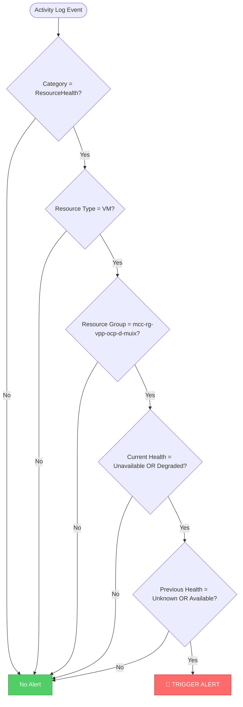
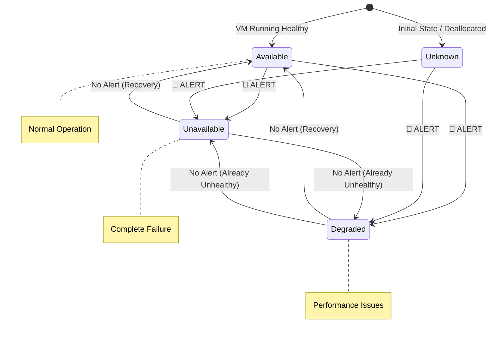
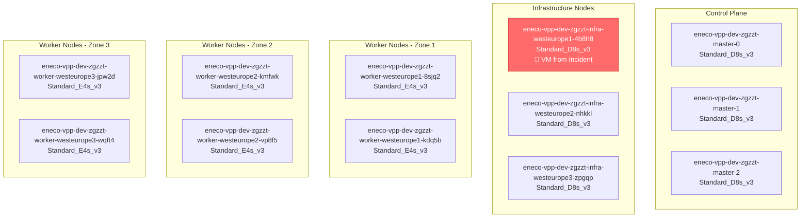
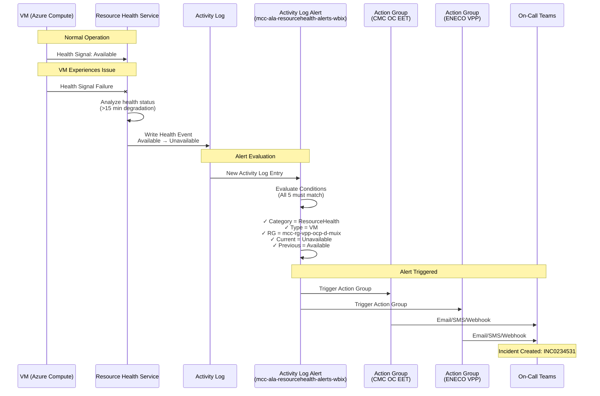
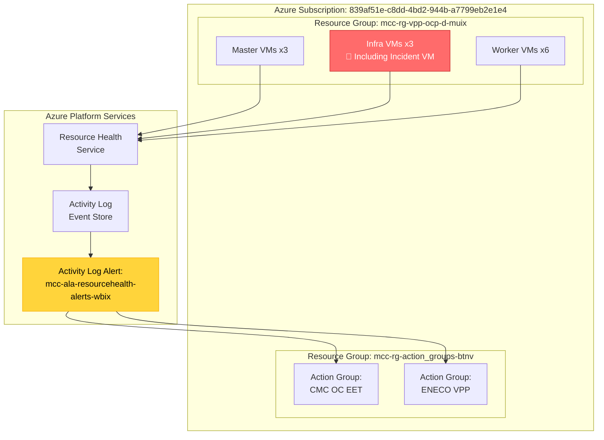
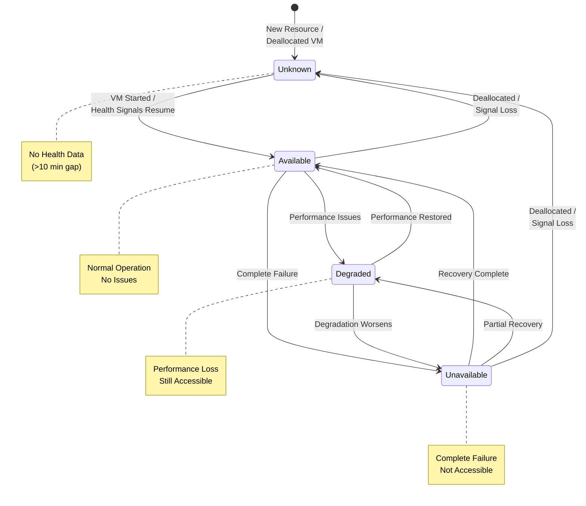

# Azure Alert Analysis: mcc-ala-resourcehealth-alerts-wbix

**Incident Reference**: INC0234531
**Alert Triggered**: November 13, 2025 15:45 UTC
**Affected Resource**: ENECO-VPP-DEV-ZGZZT-INFRA-WESTEUROPE1-4B8H8
**Document Generated**: 2025-11-17

---

## Executive Summary

This document provides comprehensive analysis of the Azure Monitor alert `mcc-ala-resourcehealth-alerts-wbix`, which monitors Resource Health status transitions for virtual machines in the ENECO VPP development OpenShift cluster. The alert triggered when infrastructure node `eneco-vpp-dev-zgzzt-infra-westeurope1-4b8h8` experienced a health status change from Available/Unknown to Unavailable/Degraded.

**Key Facts**:
- **Alert Type**: Activity Log Alert (Resource Health category)
- **Monitoring Scope**: Subscription-wide, filtered to specific resource group
- **Monitored Resources**: 12 Virtual Machines (OpenShift cluster)
- **Trigger Condition**: VM health transitions from healthy → unhealthy states
- **Notifications**: Two action groups (CMC OC EET, ENECO VPP teams)

---

## Slack Summary (Copy-Paste Ready)

**Re: INC0234531 - Alert Analysis Complete**

The `mcc-ala-resourcehealth-alerts-wbix` alert monitors health status of all 12 VMs in our ENECO VPP dev OpenShift cluster (3 masters, 3 infra nodes, 6 workers). It triggers when Azure detects a VM transitioning from healthy (Available/Unknown) to unhealthy (Unavailable/Degraded) state - essentially Azure's platform-level health check failing for >15 minutes. In this incident, infrastructure node `eneco-vpp-dev-zgzzt-infra-westeurope1-4b8h8` experienced a health status change on Nov 13 at 15:45 UTC. This alert doesn't use numeric thresholds (like CPU % or memory %) - it's purely state-based: when Azure's Resource Health service determines a VM is down or degraded, the alert fires immediately and notifies both CMC OC EET and ENECO VPP teams. To investigate, check Activity Log for root cause (platform issue vs user-initiated), verify current VM status with `az vm get-instance-view`, and assess OpenShift cluster impact with `oc get nodes`. Full analysis with troubleshooting commands, architecture diagrams, and recommendations: `azure-alert-analysis-mcc-ala-resourcehealth-alerts-wbix.md`

---

## Table of Contents

1. [Azure Resource Health Service Overview](#azure-resource-health-service-overview)
2. [Alert Configuration Details](#alert-configuration-details)
3. [Trigger Logic & Thresholds](#trigger-logic--thresholds)
4. [Monitored Infrastructure](#monitored-infrastructure)
5. [Alert Flow & Architecture](#alert-flow--architecture)
6. [Health Status Reference](#health-status-reference)
7. [Troubleshooting Guide](#troubleshooting-guide)
8. [Recommendations](#recommendations)

---

## Azure Resource Health Service Overview

### What is Azure Resource Health?

Azure Resource Health is a **personalized diagnostic service** that monitors the health status of individual Azure resources and reports on service problems affecting them. Unlike Azure Status (which covers broad regional service impacts), Resource Health provides **resource-specific health monitoring** with root cause analysis and remediation guidance.

### How It Works

Resource Health analyzes signals from various Azure services to assess individual resource condition:

1. **Continuous Monitoring**: Azure platform continuously collects health signals from resource management layers
2. **Health Status Determination**: Signals are analyzed to determine current health state (Available, Unavailable, Degraded, Unknown)
3. **Event Recording**: Health transitions lasting >15 minutes are recorded in Activity Log
4. **Root Cause Analysis**: For platform outages, Azure provides root cause details within 72 hours
5. **Integration with Monitoring**: Health events can trigger Azure Monitor alerts (like this one)

### Key Capabilities

- **Personalized Health View**: See health of YOUR resources, not just region-wide status
- **Historical Health Data**: Access past health events to identify patterns
- **Root Cause Information**: Platform-provided explanations for outages
- **SLA Verification**: Validate whether outages violated Service Level Agreements
- **Proactive Alerting**: Integrate with Azure Monitor for automated notifications

### Resource Health vs. Azure Status

| Feature | Resource Health | Azure Status |
|---------|----------------|--------------|
| **Scope** | Individual resources (your VMs, databases, etc.) | Region-wide service health |
| **Personalization** | Shows only resources you own | Shows all Azure services |
| **Root Cause** | Detailed (platform events, user actions) | General service issues |
| **Historical Data** | Full event history per resource | Service-level incidents |
| **SLA Validation** | Supports SLA verification | No SLA tracking |
| **Alerting** | Activity Log Alerts (this alert type) | Service Health Alerts |

---

## Alert Configuration Details

### Basic Information

```yaml
Alert Name: mcc-ala-resourcehealth-alerts-wbix
Alert ID: /subscriptions/839af51e-c8dd-4bd2-944b-a7799eb2e1e4/resourceGroups/mcc-rg-vpp-ocp-d-muix/providers/Microsoft.Insights/activityLogAlerts/mcc-ala-resourcehealth-alerts-wbix
Type: Microsoft.Insights/ActivityLogAlerts
Status: Enabled
Location: Global (activity log alerts are subscription-scoped)
Description: Activity alerts for ResourceHealth - Azure resourcehealth-alerts environment
```

### Scope

**Subscription-Wide Monitoring**:
- Subscription ID: `839af51e-c8dd-4bd2-944b-a7799eb2e1e4`
- The alert monitors ALL activity in this subscription but filters to specific conditions

### Action Groups

When alert triggers, notifications are sent to two action groups:

1. **CMC OC EET**
   - Resource Group: `mcc-rg-action_groups-btnv`
   - Action Group ID: `/subscriptions/6c1ab7bd-97b5-4179-8077-ac85acf7bd03/resourcegroups/mcc-rg-action_groups-btnv/providers/microsoft.insights/actiongroups/cmc oc eet`

2. **ENECO VPP**
   - Resource Group: `mcc-rg-action_groups-btnv`
   - Action Group ID: `/subscriptions/6c1ab7bd-97b5-4179-8077-ac85acf7bd03/resourcegroups/mcc-rg-action_groups-btnv/providers/microsoft.insights/actiongroups/eneco vpp`

### Tags & Metadata

```yaml
AZDOProject: MCC Landing Zone
BusinessUnit: CMC
DR: NON-DR-ENABLED
costCenter: "0"
deployedFromFolder: 400_vpp-d-workload
deploymentType: Terraform
environment: eneco
owner: CMC
resolutionGroup: CMC CloudOps Azure
```

---

## Trigger Logic & Thresholds

### Condition Logic: ALL Must Be True

The alert uses **conjunctive logic** (AND) across five conditions. ALL conditions must be satisfied simultaneously for the alert to trigger:



ASCII Fallback:
```
Activity Log Event
       ↓
[1] Category = "ResourceHealth"? → NO → No Alert
       ↓ YES
[2] Resource Type = "Microsoft.Compute/virtualmachines"? → NO → No Alert
       ↓ YES
[3] Resource Group = "mcc-rg-vpp-ocp-d-muix"? → NO → No Alert
       ↓ YES
[4] Current Health = "Unavailable" OR "Degraded"? → NO → No Alert
       ↓ YES
[5] Previous Health = "Unknown" OR "Available"? → NO → No Alert
       ↓ YES
    🚨 TRIGGER ALERT
```

### Detailed Condition Breakdown

#### Condition 1: Event Category Filter
```json
{
  "equals": "ResourceHealth",
  "field": "category"
}
```
**Purpose**: Only monitor Resource Health events (not other activity log categories like Administrative, Security, ServiceHealth)

#### Condition 2: Resource Type Filter
```json
{
  "anyOf": [
    {
      "equals": "Microsoft.Compute/virtualmachines",
      "field": "resourceType"
    }
  ]
}
```
**Purpose**: Only monitor Virtual Machines (ignores other resource types like databases, storage accounts, etc.)

#### Condition 3: Resource Group Filter
```json
{
  "anyOf": [
    {
      "equals": "mcc-rg-vpp-ocp-d-muix",
      "field": "resourceGroup"
    }
  ]
}
```
**Purpose**: Only monitor VMs in the specific OpenShift cluster resource group

#### Condition 4: Current Health Status (Unhealthy States)
```json
{
  "anyOf": [
    {
      "equals": "Unavailable",
      "field": "properties.currentHealthStatus"
    },
    {
      "equals": "Degraded",
      "field": "properties.currentHealthStatus"
    }
  ]
}
```
**Purpose**: Trigger when VM is in problem state
- **Unavailable**: VM completely down or unreachable
- **Degraded**: VM running but experiencing performance issues

#### Condition 5: Previous Health Status (Healthy States)
```json
{
  "anyOf": [
    {
      "equals": "Unknown",
      "field": "properties.previousHealthStatus"
    },
    {
      "equals": "Available",
      "field": "properties.previousHealthStatus"
    }
  ]
}
```
**Purpose**: Only alert on transitions FROM healthy → unhealthy (prevents duplicate alerts)
- **Available**: VM was healthy before the event
- **Unknown**: Initial state or VM was deallocated

### Health State Transitions Monitored

This alert specifically monitors these health transitions:



ASCII Fallback:
```
Health State Transitions:

Available ────→ Unavailable  🚨 ALERT (VM failure)
Available ────→ Degraded     🚨 ALERT (Performance degradation)
Unknown ──────→ Unavailable  🚨 ALERT (VM failure from unknown state)
Unknown ──────→ Degraded     🚨 ALERT (Performance degradation)

Unavailable ──→ Available    ✓ No Alert (Recovery)
Degraded ─────→ Available    ✓ No Alert (Recovery)
```

### What DOES NOT Trigger This Alert

- ❌ Health transitions from Unavailable → Available (recovery, not failure)
- ❌ Health transitions from Degraded → Available (recovery)
- ❌ Health transitions between unhealthy states (Degraded ↔ Unavailable)
- ❌ VMs in other resource groups
- ❌ Non-VM resources (databases, storage accounts, etc.)
- ❌ Other activity log categories (Administrative, Security, etc.)

### "Thresholds" Clarification

**Important**: This alert type does NOT use numeric thresholds (no CPU %, memory %, or count-based triggers). Instead, it uses **state-based transitions** as the trigger mechanism.

The "threshold" is conceptual:
- **Threshold**: VM health transitions from healthy state → unhealthy state
- **No Tuning**: You cannot adjust sensitivity (no "trigger after 3 occurrences" or "5-minute window")
- **Immediate**: Alert fires immediately when Azure Resource Health determines state change

---

## Monitored Infrastructure

### Resource Group: mcc-rg-vpp-ocp-d-muix

```yaml
Name: mcc-rg-vpp-ocp-d-muix
Location: West Europe
Subscription: 839af51e-c8dd-4bd2-944b-a7799eb2e1e4
Provisioning State: Succeeded
Purpose: OpenShift Container Platform Development Environment
```

### OpenShift Cluster Architecture

The monitored resource group contains an **OpenShift 4.x cluster** with 12 virtual machines:



ASCII Fallback:
```
OpenShift Cluster: eneco-vpp-dev-zgzzt

┌─────────────────────────────────────────────────────────────┐
│ Control Plane (3 Masters)                                    │
│  • master-0 (Standard_D8s_v3)                               │
│  • master-1 (Standard_D8s_v3)                               │
│  • master-2 (Standard_D8s_v3)                               │
└─────────────────────────────────────────────────────────────┘

┌─────────────────────────────────────────────────────────────┐
│ Infrastructure Nodes (3 Infra)                               │
│  • infra-westeurope1-4b8h8 (Standard_D8s_v3) 🚨 INCIDENT VM│
│  • infra-westeurope2-nhkkl (Standard_D8s_v3)                │
│  • infra-westeurope3-zpgqp (Standard_D8s_v3)                │
└─────────────────────────────────────────────────────────────┘

┌─────────────────────────────────────────────────────────────┐
│ Worker Nodes (6 Workers across 3 zones)                      │
│  Zone 1:                                                     │
│    • worker-westeurope1-8sjq2 (Standard_E4s_v3)            │
│    • worker-westeurope1-kdq5b (Standard_E4s_v3)            │
│  Zone 2:                                                     │
│    • worker-westeurope2-kmfwk (Standard_E4s_v3)            │
│    • worker-westeurope2-vp8f5 (Standard_E4s_v3)            │
│  Zone 3:                                                     │
│    • worker-westeurope3-jpw2d (Standard_E4s_v3)            │
│    • worker-westeurope3-wqft4 (Standard_E4s_v3)            │
└─────────────────────────────────────────────────────────────┘
```

### VM Specifications

| Node Type | Count | VM Size | vCPUs | RAM | Role |
|-----------|-------|---------|-------|-----|------|
| **Master** | 3 | Standard_D8s_v3 | 8 | 32 GB | Control plane, etcd, API server |
| **Infrastructure** | 3 | Standard_D8s_v3 | 8 | 32 GB | Router, registry, monitoring |
| **Worker** | 6 | Standard_E4s_v3 | 4 | 32 GB | Application workloads |
| **Total** | 12 | - | 60 | 384 GB | - |

### High Availability Design

- **Control Plane**: 3 masters provide HA for Kubernetes API and etcd
- **Infrastructure**: 3 infra nodes for router/ingress redundancy
- **Workers**: Distributed across 3 availability zones (2 per zone)
- **Alert Coverage**: ALL 12 VMs monitored by this single alert

---

## Alert Flow & Architecture

### End-to-End Alert Flow

This diagram shows the complete flow from VM health change to team notification:



ASCII Fallback:
```
Alert Flow Timeline:

1. VM Health Change
   VM (Infra Node) ──┐
                     ├──→ Health Signal Lost
   Resource Health ──┘

2. Health Status Update (>15 min)
   Resource Health ──→ Activity Log: "Available → Unavailable"

3. Alert Evaluation
   Activity Log ──→ Alert (mcc-ala-resourcehealth-alerts-wbix)
   Alert evaluates 5 conditions (ALL must match):
     ✓ Category = ResourceHealth
     ✓ Resource Type = VM
     ✓ Resource Group = mcc-rg-vpp-ocp-d-muix
     ✓ Current Health = Unavailable
     ✓ Previous Health = Available

4. Action Trigger
   Alert ──┬──→ Action Group: CMC OC EET ──→ Team Notification
           └──→ Action Group: ENECO VPP ──→ Team Notification

5. Incident Creation
   Team ──→ ServiceNow Incident: INC0234531
```

### Component Roles

| Component | Role | Responsibility |
|-----------|------|----------------|
| **VM** | Resource | Runs workload, emits health signals |
| **Resource Health** | Health Monitor | Analyzes signals, determines health status |
| **Activity Log** | Event Store | Records health transition events (durable storage) |
| **Activity Log Alert** | Filter & Router | Evaluates conditions, triggers action groups |
| **Action Groups** | Notification Dispatcher | Sends alerts via email/SMS/webhook/etc |
| **Teams** | Human Response | Investigates and resolves incidents |

### Monitoring Architecture



ASCII Fallback:
```
Monitoring Architecture:

┌─────────────────────────────────────────────────────────┐
│ Subscription: 839af51e-c8dd-4bd2-944b-a7799eb2e1e4     │
│                                                         │
│  ┌─────────────────────────────────────────────────┐  │
│  │ Resource Group: mcc-rg-vpp-ocp-d-muix           │  │
│  │                                                  │  │
│  │  12 VMs (Masters, Infra, Workers)              │  │
│  │  🚨 Including: infra-westeurope1-4b8h8         │  │
│  └─────────────────┬────────────────────────────────┘  │
│                    │                                    │
│                    ↓                                    │
│  ┌─────────────────────────────────────────────────┐  │
│  │ Azure Resource Health Service                   │  │
│  │ (Monitors all 12 VMs continuously)             │  │
│  └─────────────────┬────────────────────────────────┘  │
│                    │                                    │
│                    ↓                                    │
│  ┌─────────────────────────────────────────────────┐  │
│  │ Activity Log                                    │  │
│  │ (Records health transitions)                   │  │
│  └─────────────────┬────────────────────────────────┘  │
│                    │                                    │
│                    ↓                                    │
│  ┌─────────────────────────────────────────────────┐  │
│  │ Activity Log Alert:                             │  │
│  │ mcc-ala-resourcehealth-alerts-wbix             │  │
│  │ (Filters: VMs + RG + Health Status)           │  │
│  └─────────────────┬────────────────────────────────┘  │
│                    │                                    │
│         ┌──────────┴──────────┐                        │
│         ↓                     ↓                        │
│  ┌────────────────┐    ┌────────────────┐            │
│  │ Action Group:  │    │ Action Group:  │            │
│  │ CMC OC EET     │    │ ENECO VPP      │            │
│  └────────────────┘    └────────────────┘            │
└─────────────────────────────────────────────────────────┘
```

---

## Health Status Reference

### Four Health States

Azure Resource Health reports four possible health states for resources:

#### 1. Available ✅

**Meaning**: Resource is functioning normally with no detected issues.

**Characteristics**:
- All health signals are green
- Resource is accessible and responsive
- No platform or configuration issues detected

**Sub-State: "Recently Resolved"**:
- Shows if resource recovered from Unavailable/Degraded within last 24 hours
- Provides visibility into recent issues even after recovery

**Example**: VM running normally, accepting connections, no performance issues

---

#### 2. Unavailable ❌

**Meaning**: Resource is completely down or unreachable due to platform or non-platform event.

**Platform Events** (Azure-side issues):
- Unplanned host hardware failure
- Network infrastructure outage
- Planned maintenance (scheduled downtime)
- Azure datacenter power/cooling issues

**Non-Platform Events** (User-initiated or configuration):
- User manually stopped/deallocated VM
- VM exceeded connection limits or quotas
- Disk I/O exhaustion
- VM crash due to guest OS issue

**Duration Threshold**: Status reported after degradation lasts >15 minutes

**Root Cause Information**: Azure may provide root cause details within 72 hours for platform events

**Example**: VM completely stopped, not responding to health probes, unreachable

---

#### 3. Degraded ⚠️

**Meaning**: Resource is running and accessible but experiencing performance loss.

**Characteristics**:
- Resource still available for use
- Performance below expected levels
- Intermittent failures or slowness
- Criteria varies by resource type (VM-specific indicators)

**Common Causes**:
- High CPU/Memory utilization
- Disk I/O throttling
- Network bandwidth saturation
- Underlying host experiencing issues (but not failed)

**Example**: VM running but slow, high latency, intermittent timeouts

---

#### 4. Unknown ❓

**Meaning**: Resource Health service hasn't received data for >10 minutes.

**Common Causes**:
- VM is deallocated (expected behavior)
- Resource Health service experiencing issues
- Monitoring agent not reporting (less common for VMs)

**Important Notes**:
- **NOT always benign**: Can indicate underlying platform issues
- **Deallocated VMs**: Expected to show Unknown (VM not running)
- **Running VMs**: Unknown status may indicate problem preventing health reporting

**Example**: Deallocated VM (expected), or monitoring gap due to platform issue

---

### Health Status Transitions



---

## Troubleshooting Guide

### When Alert Fires: Investigation Steps

#### Step 1: Verify Current Resource Health

```bash
# Check Resource Health for specific VM
az resource show \
  --ids /subscriptions/839af51e-c8dd-4bd2-944b-a7799eb2e1e4/resourceGroups/mcc-rg-vpp-ocp-d-muix/providers/Microsoft.Compute/virtualMachines/[VM-NAME] \
  --query "{name:name, provisioningState:properties.provisioningState, powerState:properties.instanceView.statuses[?starts_with(code,'PowerState/')].displayStatus | [0]}"

# View Resource Health history
az rest --method get \
  --url "https://management.azure.com/subscriptions/839af51e-c8dd-4bd2-944b-a7799eb2e1e4/resourceGroups/mcc-rg-vpp-ocp-d-muix/providers/Microsoft.Compute/virtualMachines/[VM-NAME]/providers/Microsoft.ResourceHealth/availabilityStatuses?api-version=2022-10-01"
```

#### Step 2: Check Activity Log for Root Cause

```bash
# Query Activity Log for Resource Health events (last 24 hours)
az monitor activity-log list \
  --resource-group mcc-rg-vpp-ocp-d-muix \
  --start-time $(date -u -d '24 hours ago' '+%Y-%m-%dT%H:%M:%SZ') \
  --query "[?category=='ResourceHealth' && contains(resourceId, '[VM-NAME]')]" \
  -o table

# Get detailed event with root cause
az monitor activity-log list \
  --resource-group mcc-rg-vpp-ocp-d-muix \
  --start-time $(date -u -d '24 hours ago' '+%Y-%m-%dT%H:%M:%SZ') \
  --query "[?category=='ResourceHealth' && contains(resourceId, '[VM-NAME]')].[eventTimestamp, properties.cause, properties.summary]" \
  -o json
```

#### Step 3: Verify VM Operational State

```bash
# Check VM power state
az vm get-instance-view \
  --resource-group mcc-rg-vpp-ocp-d-muix \
  --name [VM-NAME] \
  --query "instanceView.statuses[?starts_with(code,'PowerState/')].{Status:displayStatus, Time:time}"

# Check provisioning state
az vm show \
  --resource-group mcc-rg-vpp-ocp-d-muix \
  --name [VM-NAME] \
  --query "{name:name, provisioningState:provisioningState, location:location}"
```

#### Step 4: OpenShift Cluster Impact Assessment

Since this is an OpenShift cluster, assess cluster-wide impact:

```bash
# SSH to any accessible master node
# Then run:

# Check node status in OpenShift
oc get nodes

# Check if affected node is Ready/NotReady
oc get node [NODE-NAME] -o wide

# Check pods affected by node issue
oc get pods --all-namespaces --field-selector spec.nodeName=[NODE-NAME]

# Check for node-level issues
oc describe node [NODE-NAME]
```

#### Step 5: Review Historical Patterns

```bash
# Query all Resource Health alerts in last 30 days
az monitor activity-log list \
  --resource-group mcc-rg-vpp-ocp-d-muix \
  --start-time $(date -u -d '30 days ago' '+%Y-%m-%dT%H:%M:%SZ') \
  --query "[?category=='ResourceHealth'].{Time:eventTimestamp, VM:resourceId, CurrentHealth:properties.currentHealthStatus, PreviousHealth:properties.previousHealthStatus, Cause:properties.cause}" \
  -o table

# Identify patterns:
# - Same VM failing repeatedly? (hardware issue)
# - Multiple VMs at same time? (platform/datacenter issue)
# - Specific time patterns? (maintenance windows, backup jobs)
```

---

### Common Root Causes & Remediation

#### Platform Events (Azure-Side)

| Root Cause | Indicators | Remediation |
|------------|-----------|-------------|
| **Unplanned Host Failure** | `properties.cause` = "PlatformInitiated"<br/>Multiple VMs on same host affected | Wait for Azure auto-healing (VM migrates to healthy host)<br/>Typical resolution: 5-15 minutes |
| **Planned Maintenance** | `properties.cause` = "PlatformInitiated"<br/>`properties.summary` mentions "maintenance" | Expected behavior during maintenance windows<br/>Review Azure Service Health for schedule |
| **Datacenter Issue** | Multiple VMs across zones affected<br/>Azure Status page shows regional issue | Open Azure support ticket<br/>Review SLA eligibility for credits |

#### Non-Platform Events (User/Config)

| Root Cause | Indicators | Remediation |
|------------|-----------|-------------|
| **Manual VM Stop** | `properties.cause` = "UserInitiated"<br/>VM power state = "Stopped (Deallocated)" | Expected if intentional stop<br/>Start VM: `az vm start --resource-group mcc-rg-vpp-ocp-d-muix --name [VM-NAME]` |
| **Guest OS Crash** | VM running but unresponsive<br/>Serial console shows kernel panic/BSOD | Access serial console for diagnostics<br/>Reboot VM: `az vm restart --resource-group mcc-rg-vpp-ocp-d-muix --name [VM-NAME]` |
| **Resource Exhaustion** | VM responsive but degraded<br/>Metrics show 100% CPU/Memory/Disk | Scale up VM size: `az vm resize`<br/>Optimize workload or add capacity |
| **Disk Throttling** | Disk I/O metrics at limit<br/>Slow performance | Upgrade to Premium SSD or increase disk size<br/>Optimize disk I/O patterns |

---

### Alert Investigation Checklist

When `mcc-ala-resourcehealth-alerts-wbix` fires:

- [ ] **Identify Affected VM**: Check incident ticket for VM name (e.g., `eneco-vpp-dev-zgzzt-infra-westeurope1-4b8h8`)
- [ ] **Query Current Health**: Run `az resource show` to verify current health status
- [ ] **Check Activity Log**: Query Resource Health events for root cause (`properties.cause`, `properties.summary`)
- [ ] **Determine Cause Type**: Platform-initiated vs User-initiated
- [ ] **Assess Cluster Impact**: For OpenShift cluster, check node status and pod disruption
- [ ] **Review Historical Pattern**: Check if this VM has repeated health issues (hardware problem indicator)
- [ ] **Verify Recovery**: Confirm VM returns to "Available" status after remediation
- [ ] **Document Findings**: Update incident ticket with root cause and resolution

---

## Recommendations

### 1. Enhance Alert Configuration

#### Current State
- Single alert monitors ALL VM types (masters, infra, workers) identically
- No differentiation by criticality
- No automated recovery actions

#### Recommended Improvements

**A. Create Tiered Alerts by Node Type**

Split into three alerts with different severity and response:

```yaml
# High-Severity: Master Node Health
Alert: mcc-ala-resourcehealth-masters-wbix
Scope: Master VMs only (master-0, master-1, master-2)
Severity: Critical (Sev-1)
Rationale: Master node failure affects entire cluster control plane

# Medium-Severity: Infrastructure Node Health
Alert: mcc-ala-resourcehealth-infra-wbix
Scope: Infra VMs only (infra-westeurope1/2/3)
Severity: High (Sev-2)
Rationale: Infra node failure affects ingress, registry, monitoring

# Low-Severity: Worker Node Health
Alert: mcc-ala-resourcehealth-workers-wbix
Scope: Worker VMs only (worker-westeurope1/2/3)
Severity: Medium (Sev-3)
Rationale: Worker node failure affects workloads but cluster remains operational
```

**B. Add Automated Remediation**

Integrate Azure Automation runbooks with action groups:

```yaml
Action Group Enhancement:
- Email/SMS: Existing (keep)
- Webhook → Azure Function/Logic App:
    Trigger: Resource Health alert
    Actions:
      1. Query VM details (az vm show)
      2. Check if VM is stopped/deallocated
      3. If UserInitiated stop → Log only (intentional)
      4. If PlatformInitiated → Attempt auto-restart
      5. If restart fails → Escalate to on-call with diagnostics
      6. Update ServiceNow incident with findings
```

---

### 2. Implement Proactive Monitoring

#### Add Metric-Based Alerts (Complement Resource Health)

Resource Health is **reactive** (reports issues after they occur). Add **proactive** metric alerts:

```yaml
# CPU Utilization Alert (Predict Resource Exhaustion)
Alert: High CPU on Infra Nodes
Metric: Percentage CPU
Threshold: >85% for 15 minutes
Action: Warning notification before Degraded state

# Disk IOPS Alert (Predict Disk Throttling)
Alert: Disk IOPS Approaching Limit
Metric: Disk IOPS Consumed Percentage
Threshold: >90% for 10 minutes
Action: Scale disk or optimize I/O before Unavailable state

# Memory Pressure Alert
Alert: Available Memory Low
Metric: Available Memory Bytes
Threshold: <2 GB for 10 minutes
Action: Investigate memory leaks before VM crash
```

---

### 3. Improve Incident Response

#### A. Runbook Automation

Create standardized runbooks in Azure Automation:

**Runbook: Investigate-ResourceHealthAlert**
```powershell
# Input: VM Resource ID from alert
# Output: Diagnostic report

1. Query current Resource Health status
2. Retrieve Activity Log events (last 24 hours)
3. Check VM power state and provisioning state
4. Run VM diagnostics (az vm run-command)
5. Check OpenShift node status (if accessible)
6. Generate report with:
   - Root cause (Platform vs User-initiated)
   - Affected pods/workloads
   - Recommended remediation steps
7. Attach report to ServiceNow incident
```

#### B. Correlation with OpenShift Monitoring

Integrate Azure alerts with OpenShift monitoring:

```yaml
# Prometheus Alert: Correlate with Azure Resource Health
alert: AzureVMHealthCorrelation
expr: |
  kube_node_status_condition{condition="Ready",status="False"} == 1
  # Triggered when OpenShift node NotReady
labels:
  severity: critical
annotations:
  description: "Node {{ $labels.node }} is NotReady. Check Azure Resource Health for underlying VM issue."
  runbook_url: "https://internal-docs/azure-resource-health-investigation"
```

---

### 4. Improve Documentation & Training

#### A. Update Incident Response Documentation

Add to team runbook:

- **Direct link** to this document for alert context
- **Decision tree**: Platform event vs User event → different response paths
- **Escalation criteria**: When to engage Azure support vs resolve internally
- **SLA validation**: How to use Resource Health data for SLA claims

#### B. Conduct Alert Training

Schedule team training covering:

- How Resource Health differs from metric alerts
- How to interpret `properties.cause` and `properties.summary` fields
- How to use Azure CLI for Resource Health investigation
- OpenShift-specific impact assessment (which workloads affected by node failure)

---

### 5. Review Alert Effectiveness Quarterly

Schedule quarterly reviews:

```yaml
Review Meeting Agenda:
1. Alert Volume Analysis
   - How many alerts fired? (count)
   - True positives vs false positives ratio
   - Mean time to resolution (MTTR)

2. Root Cause Trends
   - Most common causes (Platform vs User)
   - Recurring VM issues (hardware pattern?)
   - Correlation with maintenance windows

3. Action Group Effectiveness
   - Are right people notified?
   - Response time acceptable?
   - Any notification gaps?

4. Configuration Tuning
   - Should we split into tiered alerts? (Recommendation #1)
   - Any VMs to exclude? (test VMs, ephemeral resources)
   - Any additional action groups needed?

5. Runbook Updates
   - Are investigation steps still accurate?
   - Any new troubleshooting techniques?
   - Update this document with learnings
```

---

## Appendix: Alert Configuration (JSON)

For reference, here's the complete alert configuration as retrieved from Azure:

```json
{
  "actions": {
    "actionGroups": [
      {
        "actionGroupId": "/subscriptions/6c1ab7bd-97b5-4179-8077-ac85acf7bd03/resourcegroups/mcc-rg-action_groups-btnv/providers/microsoft.insights/actiongroups/cmc oc eet",
        "webhookProperties": {}
      },
      {
        "actionGroupId": "/subscriptions/6c1ab7bd-97b5-4179-8077-ac85acf7bd03/resourcegroups/mcc-rg-action_groups-btnv/providers/microsoft.insights/actiongroups/eneco vpp",
        "webhookProperties": {}
      }
    ]
  },
  "condition": {
    "allOf": [
      {
        "equals": "ResourceHealth",
        "field": "category"
      },
      {
        "anyOf": [
          {
            "equals": "Microsoft.Compute/virtualmachines",
            "field": "resourceType"
          }
        ]
      },
      {
        "anyOf": [
          {
            "equals": "mcc-rg-vpp-ocp-d-muix",
            "field": "resourceGroup"
          }
        ]
      },
      {
        "anyOf": [
          {
            "equals": "Unavailable",
            "field": "properties.currentHealthStatus"
          },
          {
            "equals": "Degraded",
            "field": "properties.currentHealthStatus"
          }
        ]
      },
      {
        "anyOf": [
          {
            "equals": "Unknown",
            "field": "properties.previousHealthStatus"
          },
          {
            "equals": "Available",
            "field": "properties.previousHealthStatus"
          }
        ]
      }
    ]
  },
  "description": "Activity alerts for ResourceHealth - Azure resourcehealth-alerts environment",
  "enabled": true,
  "id": "/subscriptions/839af51e-c8dd-4bd2-944b-a7799eb2e1e4/resourceGroups/mcc-rg-vpp-ocp-d-muix/providers/Microsoft.Insights/activityLogAlerts/mcc-ala-resourcehealth-alerts-wbix",
  "location": "global",
  "name": "mcc-ala-resourcehealth-alerts-wbix",
  "resourceGroup": "mcc-rg-vpp-ocp-d-muix",
  "scopes": [
    "/subscriptions/839af51e-c8dd-4bd2-944b-a7799eb2e1e4"
  ],
  "tags": {
    "AZDOProject": "MCC Landing Zone",
    "BusinessUnit": "CMC",
    "DR": "NON-DR-ENABLED",
    "costCenter": "0",
    "deployedFromFolder": "400_vpp-d-workload",
    "deploymentType": "Terraform",
    "environment": "eneco",
    "owner": "CMC",
    "resolutionGroup": "CMC CloudOps Azure"
  },
  "type": "Microsoft.Insights/ActivityLogAlerts"
}
```

---

## Document Metadata

```yaml
Document Version: 1.0
Created: 2025-11-17
Author: Azure Monitoring Analysis (Claude Code v14.5)
Alert ID: mcc-ala-resourcehealth-alerts-wbix
Incident Reference: INC0234531
Last Updated: 2025-11-17
Next Review: 2025-12-17 (monthly review recommended)
```

---

## Additional Resources

### Azure Documentation
- [Azure Resource Health Overview](https://learn.microsoft.com/en-us/azure/service-health/resource-health-overview)
- [Activity Log Alerts](https://learn.microsoft.com/en-us/azure/azure-monitor/alerts/activity-log-alerts)
- [Action Groups](https://learn.microsoft.com/en-us/azure/azure-monitor/alerts/action-groups)

### Internal Documentation
- ServiceNow Incident: INC0234531
- OpenShift Cluster Documentation: [Internal Wiki]
- Azure Landing Zone Standards: AZDOProject "MCC Landing Zone"

### Team Contacts
- **CMC OC EET**: Action group "cmc oc eet"
- **ENECO VPP Team**: Action group "eneco vpp"
- **Resolution Group**: CMC CloudOps Azure (per resource tags)
