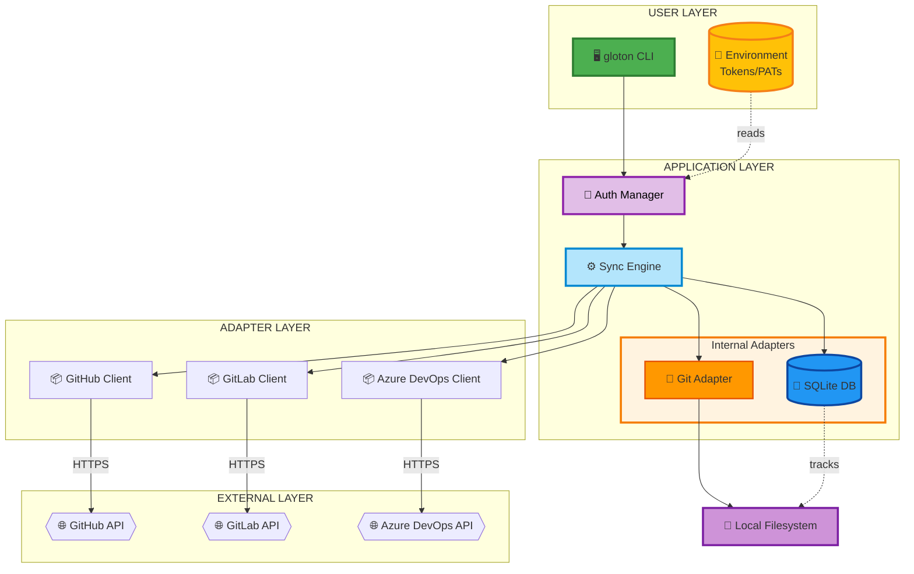

# Gloton: Universal Git Repository Synchronizer

## What is Gloton?

**gloton** (Spanish: "glutton") is an idempotent CLI tool that automatically clones and synchronizes Git repositories from cloud providers (GitHub, GitLab, Azure DevOps) to your local machine.

### Purpose

Eliminate manual repository discovery, cloning, and updating across multiple organizations, keeping full consistency across developer machines.

### Target Users

Developers managing repositories across multiple providers and organizations, which like to keep their local development environment consistent across all their machines.

## Problem Statement

### Context

Developers typically belong to multiple organizations across different Git providers, and interact with multiple repositories in each organization.

- Multiple GitHub Organizations
- Several GitLab Groups/Sub-groups
- Multiple Azure DevOps Projects
- Multiple repositories in each organization

### Current Manual Workflow Pain Points

| Pain Point | Impact |
|------------|--------|
| **Repository Discovery** | Tedious manual search across multiple providers |
| **Initial Cloning** | Repetitive `git clone` for each repository individually |
| **Keeping Updated** | Must `cd` into every directory and run `git pull` |
| **Sync Detection** | No automatic detection of out-of-sync repositories |
| **Cognitive Load** | Mental overhead of remembering exact paths and commands for each repository, or repository names and/or hierarchies |
| **Context Switching** | Mental overhead navigating between providers and remembering exact paths |

### Gloton Solution

Single command synchronizes entire organizations/projects — handles discovery, clone, sync, and update automatically with stateful tracking. Help to create a consistent local hierarchy of repositories, and keep them up to date with the latest changes from the remote repositories.

## Core Features

| Feature | Description |
|---------|-------------|
| **Multi-Provider** | Single tool for GitHub, GitLab, Azure DevOps |
| **Hierarchy Preservation** | Feature to preserve the hierarchy of the repositories, and create a consistent local hierarchy of repositories, keeping it consistent across all developer machines and between the developer machine and the remote repositories. |
| **Smart Detection** | Distinguishes new repos (clone) from existing repos (pull) |
| **Standard Auth** | Environment variables: `GITHUB_TOKEN`, `GITLAB_TOKEN`, `AZURE_DEVOPS_PAT` |
| **Local State** | SQLite database tracks synced repos, providers, timestamps |
| **Fully Customizable Synchronization Strategy** | Ability to customize the synchronization strategy for each oganization/project, e.g. sync only a subset of repositories, sync only certain branches, etc. |

## Key Concepts

### Providers

A provider is a Git repository hosting service, e.g. Azure DevOps, GitHub, GitLab. Allowed providers are:

| Provider | Provider Name | Rest API Reference Link |
|----------|-------------|----------------------------|
| Azure DevOps | `ado` | [Azure DevOps REST API](https://learn.microsoft.com/en-us/rest/api/azure/devops/?view=azure-devops-rest-7.2) |
| GitHub | `github` | [GitHub REST API](https://docs.github.com/en/rest) |
| GitLab | `gitlab` | [GitLab REST API](https://docs.gitlab.com/api/rest/) |

### Synchronization

The synchronization process is the process of syncing the repositories from the remote providers, from a given [root path](#root-path) to the local machine. Important concepts for the synchronization process are:

#### Root Path

It's the last part of the path of a given provider and organization/project. For example, if the remote repository path is `https://dev.azure.com/org-name/project-name/` the root path is `project-name`. See the following table for a reference of root paths for different providers:

| Provider | Root Path | Example |
|----------|-------------|-------------|
| Azure DevOps | `project-name` | `https://dev.azure.com/org-name/project-name/` the root path is `project-name` |
| GitHub | `org-name` | `https://github.com/org-name/` the root path is `org-name` |
| GitLab | `group-name` | `https://gitlab.com/group-name/` the root path is `group-name` |

#### Gloton Tree

It represents the local **hierarchy of repositories**, and is meant to mimic the hierarchy of the repositories within the [root path](#root-path). For example, if the root path is `project-name`, the Gloton Tree would be:

```text
provider-name/ # Example: ado
    root-path/ # Example: project-name
        repo1/ # Example: repo1
        repo2/ # Example: repo2
        repo3/ # Example: repo3
```

The Gloton Tree is tracked in the [Gloton Database](#gloton-database).

#### Gloton Database

The Gloton Database is a SQLite database that is used to track the repositories that have been synchronized, their hierarchy, and the synchronization status, their local/remote paths, etc.

## High-Level Architecture

### Intent

This diagram shows gloton's layered high-level architecture using the adapter pattern to illustrate how the Sync Engine orchestrates repository synchronization across multiple providers.



### ASCII Fallback

```text
═══════════════════════════════════════════════════════════════
                         USER LAYER
═══════════════════════════════════════════════════════════════
  ┌───────────────┐                ┌──────────────────────┐
  │  gloton CLI   │◄───────────────│  Environment Vars    │
  │               │     (reads)    │  (Tokens/PATs)       │
  └───────┬───────┘                └──────────────────────┘
          │
          ▼
═══════════════════════════════════════════════════════════════
                      APPLICATION LAYER
═══════════════════════════════════════════════════════════════
  ┌──────────────────────────────────────────────────────────┐
  │ ┌────────────────┐                                       │
  │ │  Auth Manager  │                                       │
  │ └────────┬───────┘                                       │
  │          │                                               │
  │          ▼                                               │
  │ ┌────────────────┐                                       │
  │ │  Sync Engine   │                                       │
  │ └────────┬───────┘                                       │
  │          │                                               │
  │ ┌────────┴────────────────────────────────────────────┐ │
  │ │        INTERNAL ADAPTERS                            │ │
  │ │  ┌──────────────────┐    ┌──────────────────────┐  │ │
  │ │  │   SQLite DB      │    │   Git Adapter        │  │ │
  │ │  │  (State & Meta)  │    │   (clone/pull)       │  │ │
  │ │  └──────────────────┘    └──────────────────────┘  │ │
  │ └─────────────────────────────────────────────────────┘ │
  └──────────┬───────────────┬───────────────┬──────────────┘
             │               │               │
═══════════════════════════════════════════════════════════════
                        ADAPTER LAYER
═══════════════════════════════════════════════════════════════
             │               │               │
        ┌────▼────┐     ┌────▼────┐     ┌───▼─────┐
        │ GitHub  │     │ GitLab  │     │  Azure  │
        │  HTTP   │     │  HTTP   │     │ DevOps  │
        │ Client  │     │ Client  │     │  HTTP   │
        └────┬────┘     └────┬────┘     └────┬────┘
             │               │               │
      HTTPS+Token     HTTPS+Token       HTTPS+PAT
             │               │               │
═══════════════════════════════════════════════════════════════
                       EXTERNAL LAYER
═══════════════════════════════════════════════════════════════
             │               │               │
        ┌────▼────┐     ┌────▼────┐     ┌───▼─────┐
        │ GitHub  │     │ GitLab  │     │  Azure  │
        │   API   │     │   API   │     │ DevOps  │
        │         │     │         │     │   API   │
        └─────────┘     └─────────┘     └─────────┘

        ┌──────────────────────────────────────────┐
        │    Local Filesystem                      │
        │    org/project/repo/                     │
        │         ▲                                │
        │         │                                │
        │    Git Adapter writes here               │
        │    SQLite DB tracks state                │
        └──────────────────────────────────────────┘
```

### Architecture Layers

| Layer | Components | Responsibility |
|-------|------------|----------------|
| **User Layer** | CLI, Environment Variables | User interaction and lightweight configuration |
| **Application Layer** | Auth Manager, Sync Engine, Internal Adapters (SQLite DB, Git Adapter) | Core business logic and state management |
| **Adapter Layer** | GitHub/GitLab/Azure DevOps HTTP Clients | Protocol translation (internal ↔ external APIs) |
| **External Layer** | Provider APIs, Local Filesystem | External dependencies and persistent storage |

### Design Principles

Gloton follows core design principles that ensure simplicity, reliability, and maintainability. For detailed information on design philosophy, architectural patterns, and technical standards, see [Design Principles & Technical Guidelines](./01-engineering-principles.md).

## Workflow

There are two main flows to consider:

### `init` flow

This flow is used to initialize and ingest the repositories that belong to a given provider (e.g. Azure DevOps, GitHub, GitLab) from an initial [root path](#root-path).

The command is `gloton init <PROVIDER> <ROOT_PATH> [OPTIONS]`.

>**Note**: The `init` command is meant to be used for the first time to ingest the repositories from the remote providers to the local machine.

### `sync` flow

This flow is used to sync the repositories that belong to a given provider (e.g. Azure DevOps, GitHub, GitLab) from an initial [root path](#root-path). It only works when an initial [root path](#root-path) has been initialized using the [`init` flow](#init-flow).

The command is `gloton sync <PROVIDER> <ROOT_PATH> [OPTIONS]`.

## Configuration

### Required Configuration for Providers

The required configuration is per-provider:

| Provider | Configuration |
|----------|---------------|
| Azure DevOps | `AZURE_DEVOPS_PAT` |
| GitHub | `GITHUB_TOKEN` |
| GitLab | `GITLAB_TOKEN` |

## Command Structure

### Primary Commands

Primary commands perform mutating operations (cloning, syncing repositories).

#### `init` command

This command is to ingest and pull all the repositories from a given provider and root path to the local machine. It basically **connects** for the first time a remote provider and path (E.g.: organization and/or projects) to the local machine.

```bash
# Initialize repositories from remote provider (first-time setup)
gloton init <PROVIDER> <ROOT_PATH> [OPTIONS]
  # Optional arguments:
  --depth <N>              # Clone with limited history depth
  --filter <PATTERN>       # Clone only repos matching pattern
  --exclude <PATTERN>      # Exclude repos matching pattern
```

The global optional arguments are:

| Argument | Description |
|----------|-------------|
| `--depth <N>` | Clone with limited history depth. |
| `--filter <PATTERN>` | Clone only repositories matching pattern. |
| `--exclude <PATTERN>` | Exclude repositories matching pattern. |

##### Azure DevOps

For [Azure DevOps](https://learn.microsoft.com/en-us/azure/devops/organizations/projects/create-project?view=azure-devops&tabs=preview-page), the arguments are:

| Argument | Description |
|----------|-------------|
| `--organization <ORG_NAME>` | The organization name of the remote provider. |

##### GitHub

For [GitHub](https://docs.github.com/en/organizations/organizing-members-into-teams/creating-a-team), the arguments are:

| Argument | Description |
|----------|-------------|
| `--organization <ORG_NAME>` | The organization name of the remote provider. |

##### GitLab

For [GitLab](https://docs.gitlab.com/ee/user/project/working_with_projects.html), the arguments are:

| Argument | Description |
|----------|-------------|
| `--group <GROUP_NAME>` | The group name of the remote provider. |
| `--subgroup <SUBGROUP_NAME>` | The subgroup name of the remote provider. |

##### Global Optional Arguments

| Argument | Description |
|----------|-------------|
| `--depth <N>` | Clone with limited history depth. |
| `--filter <PATTERN>` | Clone only repositories matching pattern. |
| `--exclude <PATTERN>` | Exclude repositories matching pattern. |
#### `sync` command

This command is to sync the repositories from a given provider and root path to the local machine, when it was already ingested using the [`init` command](#init-command).

```bash
# Synchronize repositories (pull updates, clone new repos)
gloton sync <PROVIDER> <ROOT_PATH> [OPTIONS]
  --pull-only              # Pull only the repositories that are already cloned
  --clone-only             # Clone only the repositories that are not already cloned
  --parallel <N>           # Concurrent operations (default: 4)
```

**Examples:**

**Basic usage** - Sync all repositories (pull existing, clone new):

```bash
# Daily sync for Azure DevOps project
gloton sync ado platform-services

# Daily sync for GitHub organization
gloton sync github acme-corp
```

**Pull-only mode** - Update existing repositories without cloning new ones:

```bash
# Quick update of already-cloned repositories
gloton sync ado platform-services --pull-only
```

**Clone-only mode** - Clone new repositories without pulling existing ones:

```bash
# Discover and clone new repositories added to the organization
gloton sync github acme-corp --clone-only
```

**Parallel execution** - Speed up sync with concurrent operations:

```bash
# Sync with 8 concurrent operations (useful for large organizations)
gloton sync ado platform-services --parallel 8

# Conservative sync with 2 concurrent operations (low bandwidth)
gloton sync gitlab startup-labs --parallel 2
```
